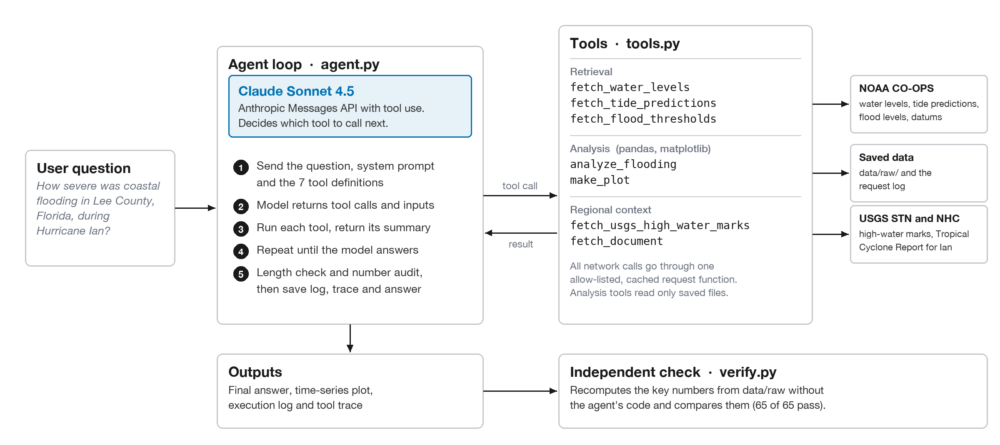

# Homework 2: Hurricane Ian coastal flooding agent (CGN 6905)

I built a small LLM agent that retrieves NOAA water-level data for Fort Myers, Florida, analyzes it, and answers questions about coastal flooding in Lee County during Hurricane Ian (September 27-30, 2022). The model decides which tools to call. The tools do all of the data work, and every number in an answer has to come from a tool result.

## How to run

Python 3.9 or newer. I used Python 3.12.

```
pip install -r requirements.txt
echo "ANTHROPIC_API_KEY=your-key-here" > .env      # .env is listed in .gitignore and never shared

python agent.py --preset main     # the main homework question
python agent.py --preset q1       # demo question 1
python agent.py --preset q2       # demo question 2
python agent.py "Your own question about Ian water levels" --tag mytag
python agent.py --preset q1 --refresh   # download everything again instead of using data/

python verify.py                  # independent check of the key numbers
python hwm_map.py                 # optional map of USGS high-water marks
```

Each agent run takes about 40 to 65 seconds and costs about 15 to 35 cents. The key is read from `.env` or the environment and is never printed or logged.

## Architecture



The agent is a plain tool-use loop on the Anthropic Python SDK with Claude Sonnet 4.5. I did not use LangChain or a similar framework because the SDK already supports tool use, and a short loop keeps every tool call, input and result visible in the log. The model decides which tool to call and with what inputs. The tools do all retrieval and arithmetic. The fetch tools save the raw responses, and the analysis tools read only those saved files, so an analysis cannot run on data that was never retrieved. After the model answers, the loop checks the answer length and audits every number in the answer against the tool outputs.

## Demo video

`demo/hw2_demo.mp4` (1:57) shows both demo questions typed into the terminal and answered in live runs, with each tool call, its inputs and its result, then the final answers, a `verify.py` check and the plot. Waits for the model are sped up and marked in the title bar. The `q1` and `q2` logs in `outputs/` are from the runs in the video.

## Files

| File | What it is |
| --- | --- |
| `agent.py` | The tool-use loop. Sends the question to the model, runs the tools it asks for, prints and saves the execution log. |
| `tools.py` | The seven tools, the tool definitions the model sees, and the cached, allow-listed network code. |
| `verify.py` | Recomputes peak, peak time, maximum residual, missing counts, threshold exceedances and USGS statistics from the raw files, without importing `tools.py`. |
| `hwm_map.py` | Optional extension. Map and histogram of Lee County high-water marks with the gauge peak converted to NAVD88. |
| `assessment.md` | The roughly 200-word assessment with references. |
| `reflection.md` | The reflection (architecture, how the agent decides, strengths, limits, one improvement). |
| `docs/architecture.png` | Architecture diagram. |
| `demo/hw2_demo.mp4` | The 2-minute demo video. |
| `outputs/fort_myers_ian_water_levels.png` | The time-series plot (observed, predicted, NWS flood thresholds, residual). |
| `outputs/lee_county_hwm_map.png` | Optional extension figure. |
| `outputs/{main,q1,q2}_answer.md` | Final answer from each run. |
| `outputs/{main,q1,q2}_log.txt` and `logs/{main,q1,q2}.log` | Execution logs (same text). |
| `outputs/{main,q1,q2}_tool_trace.json` | Every tool call with its input and full result. |
| `outputs/analysis_8725520_20220927_20220930_MHHW.json` | Output of the analysis tool. `verify.py` compares against it. |
| `outputs/usgs_hwm_*.csv` | The high-water marks used for each area. |
| `outputs/verify_output.txt` | Output of `verify.py`. |
| `data/raw/` | Raw API responses (NOAA water levels, predictions, flood levels, datums, USGS events and marks). |
| `data/documents/AL092022_Ian_*.txt` | Text extracted from the National Hurricane Center report. The 7 MB PDF is not included. |
| `data/request_log.jsonl` | Every request URL, time, cache hit or miss, size and SHA-256. |

## The tools

| Tool | What it does |
| --- | --- |
| `fetch_water_levels` | Observed 6-minute water levels from the NOAA CO-OPS Data API. |
| `fetch_tide_predictions` | Predicted astronomical tide from the same API. |
| `fetch_flood_thresholds` | Minor, moderate and major flood thresholds from the CO-OPS metadata API, converted to the datum in use. |
| `analyze_flooding` | pandas analysis of the saved data (peak, residual, gaps, exceedances, durations). Reads files, does not download. |
| `make_plot` | matplotlib plot of the saved data. |
| `fetch_usgs_high_water_marks` | USGS STN surveyed high-water marks for Ian in Lee County, summarized by area. |
| `fetch_document` | Excerpts with page numbers from a NOAA, NWS or USGS document. |

The model is `claude-sonnet-4-5-20250929` through the Anthropic Messages API. The loop never fixes the order of the tools. The system prompt gives the study defaults, the rules about numbers and data gaps, and the answer format. The model picks the calls from the question and the tool descriptions. For the main question and Q1 it used all seven tools. For Q2 it used the three fetch tools, the analysis tool and the high-water-mark tool, and chose not to make a plot or open the report.

Two safeguards sit in the loop. Analysis and plot tools only read cached files, so the model has to retrieve data first. After the final answer the log prints a number audit that checks each number in the answer against the tool outputs. If an answer is longer than 240 words the loop asks the model to shorten it, at most twice.

## Data sources

| Data | Request URL |
| --- | --- |
| Observed water level | `https://api.tidesandcurrents.noaa.gov/api/prod/datagetter?product=water_level&application=cgn6905_hw2_agent&begin_date=20220927&end_date=20220930&datum=MHHW&station=8725520&time_zone=lst_ldt&units=english&format=json` |
| Predicted tide | `https://api.tidesandcurrents.noaa.gov/api/prod/datagetter?product=predictions&application=cgn6905_hw2_agent&begin_date=20220927&end_date=20220930&datum=MHHW&station=8725520&time_zone=lst_ldt&units=english&format=json&interval=6` |
| Flood thresholds | `https://api.tidesandcurrents.noaa.gov/mdapi/prod/webapi/stations/8725520/floodlevels.json?units=english` |
| Datum heights | `https://api.tidesandcurrents.noaa.gov/mdapi/prod/webapi/stations/8725520/datums.json?units=english` |
| USGS event list | `https://api.waterdata.usgs.gov/stnservices/events/` (event 325 is "2022 Ian") |
| USGS high-water marks | `https://api.waterdata.usgs.gov/stnservices/hwms/filteredhwms/?event=325&states=FL` |
| NHC Tropical Cyclone Report, Hurricane Ian | `https://www.nhc.noaa.gov/data/tcr/AL092022_Ian.pdf` (version dated 12 March 2026, I read pages 8 to 10, 13 and Table 3 on page 24) |
| Description of NOAA flood thresholds | `https://tidesandcurrents.noaa.gov/inundationdb/` (FAQ) |

The old STN address `stn.wim.usgs.gov/STNServices` now redirects to a web app. I found the current service root `https://api.waterdata.usgs.gov/stnservices/` in that app's script and used it. The agent can only contact hosts under `tidesandcurrents.noaa.gov`, `nhc.noaa.gov`, `weather.gov` and `usgs.gov`.

## Units, datum and time zone

- Units: feet (`units=english`).
- Datum: feet above MHHW (Mean Higher High Water) for all gauge data, so observed and predicted values share one datum. The USGS marks are in NAVD88, so I also convert the gauge peak to NAVD88 for comparison. The CO-OPS datums resource puts MHHW 5.68 ft and NAVD88 5.40 ft above station datum. That makes MHHW 0.28 ft above NAVD88, so a level in NAVD88 is the MHHW level plus 0.28 ft. The peak of 7.257 ft above MHHW is 7.54 ft above NAVD88.
- Time zone: I request `lst_ldt` in every call, which is local clock time. On these dates that is EDT (UTC-4). The peak at 18:30 EDT is 22:30 UTC. The window has no daylight-saving change.

## Flood thresholds

The thresholds come from the CO-OPS metadata API (`floodlevels`). It returns two sets. The NWS set was defined by the local NWS forecast office from impact monitoring. The NOS set was derived by NOAA with one method for all stations (NOAA Technical Report NOS CO-OPS 086). The agent reports the NWS set as the main one and computes both.

The metadata API does not state the datum of these values. The Coastal Inundation Dashboard script subtracts the plotted datum height from them, so I treat them as heights above station datum. Subtracting MHHW (5.68 ft) gives NWS thresholds of exactly 2.00, 3.50 and 5.00 ft above MHHW, which supports that reading. This is an inference and I label it as one in the tool output.

The thresholds are the values NOAA publishes now (retrieved 2026-10-25). Using them for a 2022 event is retrospective. The values or datums in force in 2022 may have been different.

## Results the tools produced (main run)

From `outputs/analysis_8725520_20220927_20220930_MHHW.json`, feet above MHHW, EDT:

- Peak observed water level: 7.257 ft at 2022-09-28 18:30 (22:30 UTC).
- Maximum storm residual (observed minus predicted at the same timestamp): 7.249 ft at 2022-09-28 18:18. The predicted tide was 0.002 ft at that time.
- Most negative residual: -1.441 ft at 2022-09-28 05:18, before the surge arrived.
- NWS thresholds above MHHW: minor 2.00, moderate 3.50, major 5.00. All three were exceeded for 20.3, 13.7 and 7.5 hours.
- NOS thresholds above MHHW: minor 1.69, moderate 2.66, major 3.89. All three were exceeded for 21.9, 17.2 and 11.8 hours.
- Hours are counts of 6-minute observations above the threshold times 0.1 hour.

## Data gaps and quality limits

- Observed water level: 960 of 960 expected 6-minute timestamps are present. None are missing. All 960 are verified data, none are preliminary, and no quality flags are set.
- Predictions: 960 of 960 present. All 960 timestamps match, so residuals use every sample. Nothing was interpolated anywhere.
- The 6-minute sample at the peak has a sigma of 0.217 ft, compared with a median of 0.036 ft for the window. Sigma is the spread of the 1-second readings inside the sample, so the peak sample is noisier than usual.
- The datums resource lists a record high of 12.923 ft above station datum on 2022-09-29 at 02:30. That does not match the 6-minute series, whose peak is about 12.93 ft above station datum on 2022-09-28 at 18:30 LDT. I did not use that field and I could not explain the difference.
- USGS marks: 257 marks in Lee County, 251 kept after dropping the 6 rated Poor or worse. Height above ground is missing for 8 of the 257 marks. Marks are single surveyed peaks and seed lines can include wave effects.
- The Fort Myers Beach and Sanibel areas are rough bounding boxes, defined in `tools.py` and in the tool output. They are not municipal boundaries.

## Checks

`verify.py` passed 65 of 65 checks (`outputs/verify_output.txt`). It recomputes the peak, peak time, residual, missing counts, every threshold exceedance (count, hours, first and last time) and the USGS statistics for each area, and they match the agent's tool output exactly.

It also compares with Table 3 of the NHC report. For Fort Myers (FMRF1) the report gives storm surge 7.25 ft, storm tide 7.53 ft (NAVD88) and inundation 7.26 ft (NOS gauges use height above MHHW as the proxy). My values are 7.249, 7.54 and 7.257. The 0.01 ft difference in storm tide comes from rounding of the two datum heights. USGS mark FLLEE32905 is 7.7 ft NAVD88 and 4.43 ft above ground in both Table 3 and the STN data.

In the Q1 answer the model wrote the peak time as 1830. That is 18:30 and my number audit flags it only because there is no colon.

## What I would tell a reader to be careful about

- The answers differ in wording from run to run, because the model is not deterministic. The numbers come from the tools and do not change.
- One hurricane describes the flooding of this event only. It does not by itself give long-term flood probabilities or return periods.
- The gauge measures water-surface elevation at one place. It does not give inundation depth on streets or at buildings, and the high-water marks give depth only at the spot of each mark.
- I ran the agent four times while tuning the system prompt, and kept three of the four logs in `logs/development/`. They are not included here. The prompt changes were: ask for the plot when the question is about severity, ask for a two-paragraph layout, ask it to compare marks near the gauge with marks in other areas, and add the length check.
- Total Anthropic usage for all runs, including the development runs and the runs recorded for the demo video, was about 610,000 input tokens and 30,900 output tokens, roughly $2.29 at Sonnet 4.5 list prices ($3 and $15 per million tokens). The usage ledger is `logs/usage_ledger.jsonl`. The `q1` and `q2` logs in `outputs/` are from the runs shown in the video.

## Optional extension

The agent has a fourth data tool, `fetch_usgs_high_water_marks`, that retrieves the USGS Short-Term Network high-water marks for Hurricane Ian in Lee County and summarizes them for four areas: the whole county, the area within 5 km of the gauge, Fort Myers Beach, and Sanibel and Captiva. The gauge peak is converted from MHHW to NAVD88 with the CO-OPS datum heights (MHHW is 0.28 ft above NAVD88 at this station) before any comparison, because the marks are surveyed in NAVD88.

`hwm_map.py` draws `outputs/lee_county_hwm_map.png`: a map of the 251 marks colored by elevation, and a histogram with the gauge peak (7.54 ft NAVD88) marked. It has no basemap, because the assignment limits network access to NOAA and USGS hosts. It is a separate script, not an agent tool.

Why flooding differed across the county. Marks near the gauge had a median of 7.5 ft NAVD88, close to the gauge peak. Marks at Fort Myers Beach (median 12.3 ft) and on Sanibel and Captiva (median 11.1 ft) were 3.5 to 5 ft higher. The barrier islands face the Gulf directly, so they took the open-coast surge with waves on top, while the gauge sits on the Caloosahatchee River in downtown Fort Myers. Coastline shape and nearshore depth also change how high the water piles up. Some marks are seed lines or mud lines that can include wave effects, so they are not all the same kind of measurement.

What more data would be needed to estimate inundation depth at a road or a building. Depth on the ground is the water-surface elevation minus the ground elevation at that spot, both in the same datum. That needs ground elevations from a lidar elevation model (for example USGS 3DEP), road and bridge deck elevations, and first-floor elevations for buildings. It also needs a water-surface estimate between the marks, either interpolated from the marks or from a storm surge model such as SLOSH or ADCIRC, and the timing of the water at that place to know how long a road was under water.
